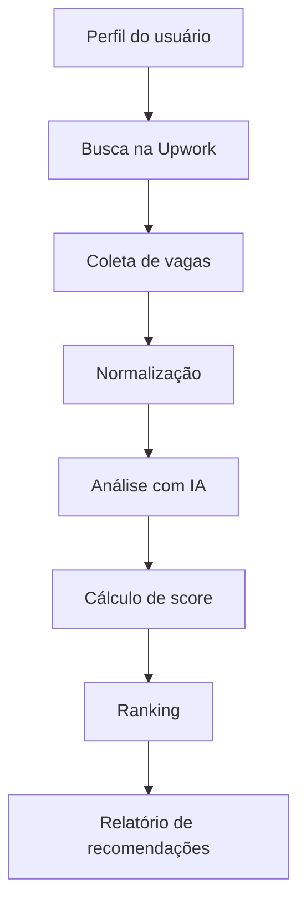

# Freela Agent — Specification-Driven Development

## 1. Objetivo do produto

Construir um agente local, inicialmente focado na Upwork, capaz de recomendar oportunidades freelancer compatíveis com o perfil técnico do usuário.

O MVP deve validar se o agente consegue reduzir o tempo de busca manual e aumentar a qualidade das oportunidades encontradas.

---

## 2. Escopo do MVP

### Incluído no MVP

- Execução local.
- Perfil técnico configurável em arquivo JSON.
- Coleta de oportunidades da Upwork.
- Normalização dos dados coletados.
- Análise de aderência entre vaga e perfil.
- Ranking das melhores oportunidades.
- Persistência local.
- Interface simples via CLI ou API local.
- Exportação das recomendações em JSON/Markdown.

### Fora do MVP

- Login multiusuário.
- Pagamentos.
- SaaS público.
- Aplicação automática nas vagas.
- Scraping massivo.
- Suporte inicial a múltiplas plataformas.

---

## 3. Persona principal

Desenvolvedor sênior buscando contratos internacionais em plataformas freelancer.

Perfil de referência:

- Forte experiência em Java, Spring Boot, Node.js, React e bancos relacionais.
- Interesse em vagas remotas.
- Preferência por contratos em dólar.
- Desejo de economizar tempo na triagem de oportunidades.

---

## 4. Fluxo principal



---

## 5. Requisitos orientados à especificação

### SPEC-001 — Configuração do perfil

O sistema deve carregar um perfil local em `profile.json`.

#### Entrada esperada

```json
{
  "name": "Nicodemos",
  "title": "Senior Software Developer",
  "technologies": [
    "Java",
    "Spring Boot",
    "Node.js",
    "React",
    "JavaScript",
    "Docker",
    "PostgreSQL",
    "Oracle"
  ],
  "experienceYears": 17,
  "englishLevel": "intermediate",
  "minimumHourlyRate": 35,
  "preferredJobTypes": ["backend", "fullstack", "api", "integration"],
  "avoid": ["wordpress", "crypto scam", "adult content"]
}
```

#### Critérios de aceitação

- Se o arquivo não existir, o sistema deve informar erro amigável.
- Se campos obrigatórios estiverem ausentes, deve listar os campos faltantes.
- O perfil deve ser carregado antes de qualquer busca.

---

### SPEC-002 — Busca de oportunidades na Upwork

O sistema deve buscar oportunidades relacionadas às tecnologias e preferências do perfil.

#### Estratégia inicial

Gerar consultas a partir do perfil:

- `Java Spring Boot`
- `Node.js backend`
- `React fullstack`
- `REST API`
- `Docker backend`

#### Dados mínimos por vaga

```json
{
  "platform": "upwork",
  "externalId": "string",
  "title": "string",
  "description": "string",
  "url": "string",
  "budget": {
    "type": "hourly | fixed | unknown",
    "min": 0,
    "max": 0,
    "currency": "USD"
  },
  "experienceLevel": "entry | intermediate | expert | unknown",
  "postedAt": "ISO-8601",
  "skills": ["string"]
}
```

#### Critérios de aceitação

- O sistema deve evitar duplicidade pelo `externalId` ou `url`.
- A coleta deve limitar a quantidade de vagas por execução.
- Falhas na Upwork não devem derrubar a aplicação inteira.
- O sistema deve registrar logs básicos da coleta.

---

### SPEC-003 — Normalização das vagas

Toda vaga coletada deve ser convertida para o modelo interno `JobOpportunity`.

#### Modelo interno

```ts
type JobOpportunity = {
  id: string;
  platform: "upwork";
  title: string;
  description: string;
  url: string;
  budgetType: "hourly" | "fixed" | "unknown";
  budgetMin?: number;
  budgetMax?: number;
  currency: "USD";
  experienceLevel: "entry" | "intermediate" | "expert" | "unknown";
  postedAt?: string;
  detectedSkills: string[];
  rawData?: unknown;
};
```

#### Critérios de aceitação

- Campos ausentes devem receber valor `unknown`, `null` ou array vazio.
- A aplicação não deve quebrar por mudança pequena no formato da vaga.
- O dado bruto pode ser armazenado para auditoria.

---

### SPEC-004 — Análise semântica com IA

O sistema deve usar IA para enriquecer a vaga.

#### A IA deve retornar

```json
{
  "summary": "string",
  "requiredSkills": ["string"],
  "seniority": "junior | mid | senior | unknown",
  "jobType": "backend | frontend | fullstack | devops | mobile | data | unknown",
  "redFlags": ["string"],
  "positiveSignals": ["string"]
}
```

#### Critérios de aceitação

- A resposta da IA deve ser validada antes de ser usada.
- Se a IA falhar, o sistema deve continuar com matching básico.
- Red flags devem reduzir a pontuação da vaga.

---

### SPEC-005 — Cálculo de score

O sistema deve gerar um score de 0 a 100.

#### Fórmula inicial

```text
score =
  technologyMatch * 40 +
  seniorityMatch * 20 +
  budgetMatch * 15 +
  jobTypeMatch * 15 +
  qualitySignals * 10 -
  redFlagPenalty
```

#### Regras

- `technologyMatch`: proporção entre skills da vaga e skills do perfil.
- `seniorityMatch`: maior para vagas senior/expert.
- `budgetMatch`: maior quando orçamento >= mínimo desejado.
- `jobTypeMatch`: maior quando o tipo da vaga está nas preferências.
- `qualitySignals`: cliente claro, escopo bem definido, orçamento compatível.
- `redFlagPenalty`: escopo confuso, orçamento baixo, tecnologias indesejadas.

#### Critérios de aceitação

- Toda recomendação deve conter score.
- Toda recomendação deve conter justificativa textual.
- Vagas abaixo de um score mínimo configurável devem ser ocultadas.

---

### SPEC-006 — Geração de relatório

O sistema deve gerar um relatório com as melhores oportunidades.

#### Formato Markdown

```md
# Recomendações Upwork

## 1. Título da vaga

- Score: 87/100
- Plataforma: Upwork
- Orçamento: USD 40/h
- Link: ...
- Resumo: ...
- Motivos do match:
  - Java + Spring Boot
  - Perfil senior
  - API REST
- Pontos de atenção:
  - Cliente novo na plataforma
```

#### Critérios de aceitação

- O relatório deve ser salvo em `/output/recommendations.md`.
- Deve haver também uma saída JSON em `/output/recommendations.json`.
- As oportunidades devem vir ordenadas por score decrescente.

---

## 6. Arquitetura proposta para o MVP

```text
freela-agent/
├── src/
│   ├── config/
│   │   └── loadProfile.ts
│   ├── platforms/
│   │   └── upwork/
│   │       ├── upwork.search.ts
│   │       ├── upwork.parser.ts
│   │       └── upwork.types.ts
│   ├── ai/
│   │   ├── analyzeJob.ts
│   │   └── prompts.ts
│   ├── scoring/
│   │   ├── calculateScore.ts
│   │   └── explainScore.ts
│   ├── storage/
│   │   ├── db.ts
│   │   └── repositories.ts
│   ├── reports/
│   │   ├── markdownReport.ts
│   │   └── jsonReport.ts
│   └── main.ts
├── data/
│   └── profile.json
├── output/
├── package.json
└── README.md
```

---

## 7. Contratos principais

### UserProfile

```ts
type UserProfile = {
  name: string;
  title: string;
  technologies: string[];
  experienceYears: number;
  englishLevel: "basic" | "intermediate" | "advanced" | "fluent";
  minimumHourlyRate: number;
  preferredJobTypes: string[];
  avoid: string[];
};
```

### Recommendation

```ts
type Recommendation = {
  job: JobOpportunity;
  score: number;
  summary: string;
  matchReasons: string[];
  warnings: string[];
  analyzedAt: string;
};
```

---

## 8. Prompt base para análise da vaga

```text
Você é um agente especializado em avaliar oportunidades freelancer para desenvolvedores de software.

Analise a vaga abaixo e retorne apenas JSON válido.

Perfil do usuário:
{{USER_PROFILE}}

Vaga:
{{JOB_DESCRIPTION}}

Retorne:
{
  "summary": "",
  "requiredSkills": [],
  "seniority": "",
  "jobType": "",
  "redFlags": [],
  "positiveSignals": []
}
```

---

## 9. Backlog inicial

### Sprint 1 — Base local

- Criar projeto Node.js com TypeScript.
- Criar carregamento de `profile.json`.
- Criar modelos TypeScript.
- Criar mock de vagas Upwork.
- Criar cálculo básico de score.
- Gerar relatório Markdown.

### Sprint 2 — Integração Upwork

- Criar coletor real ou semi-automatizado da Upwork.
- Normalizar vagas.
- Evitar duplicidade.
- Salvar histórico local.

### Sprint 3 — IA

- Integrar LLM.
- Criar prompt de análise.
- Validar JSON retornado.
- Incorporar sinais positivos e red flags no score.

### Sprint 4 — Produto local utilizável

- Criar CLI.
- Permitir parâmetros de busca.
- Gerar relatório final.
- Adicionar logs.
- Documentar execução.

---

## 10. Estratégia pós-MVP

### Fase 2 — Melhorias locais

- Feedback do usuário: interessante, ignorar, aplicado.
- Aprendizado com feedback.
- Envio diário por Telegram.
- Exportação para Notion ou Google Sheets.
- Configuração de múltiplos perfis.

### Fase 3 — Novas plataformas

Ordem sugerida:

1. Freelancer.com
2. Guru
3. Fiverr
4. RemoteOK
5. Wellfound
6. Toptal

Para cada plataforma, criar um módulo seguindo o contrato:

```ts
interface PlatformProvider {
  name: string;
  search(profile: UserProfile): Promise<JobOpportunity[]>;
  normalize(raw: unknown): JobOpportunity;
}
```

### Fase 4 — Matching avançado

- Embeddings do perfil.
- Embeddings das vagas.
- Similaridade vetorial.
- Histórico de candidaturas.
- Sugestão de proposta personalizada.
- Geração de cover letter.

### Fase 5 — SaaS

- Autenticação.
- Multiusuário.
- PostgreSQL.
- Fila de jobs.
- Dashboard web.
- Plano gratuito e plano pago.
- Cobrança recorrente.
- Limites por usuário.
- Painel administrativo.

---

## 11. Restrições importantes

- Respeitar termos de uso das plataformas.
- Evitar scraping agressivo.
- Preferir APIs oficiais quando disponíveis.
- Não automatizar candidatura sem revisão humana.
- Não armazenar credenciais sensíveis em texto puro.

---

## 12. Métricas de validação

- Quantidade de vagas coletadas por execução.
- Percentual de vagas relevantes.
- Tempo economizado por dia.
- Quantidade de candidaturas feitas.
- Taxa de resposta dos clientes.
- Taxa de entrevistas geradas.

---

## 13. Definição de pronto do MVP

O MVP estará pronto quando:

- O usuário conseguir rodar o agente localmente.
- O agente carregar o perfil.
- O agente coletar ou simular vagas da Upwork.
- O agente gerar score e justificativa.
- O agente gerar relatório Markdown e JSON.
- O usuário conseguir revisar as melhores oportunidades em até 5 minutos.
